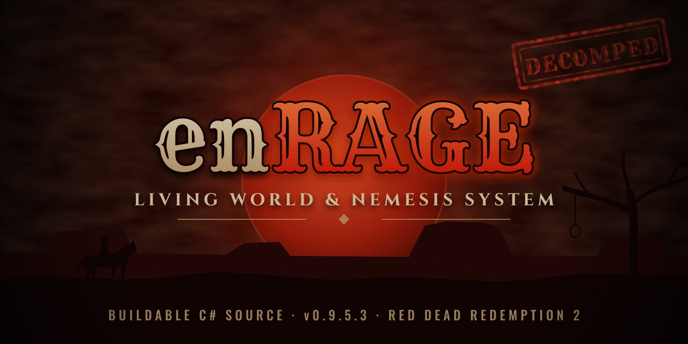
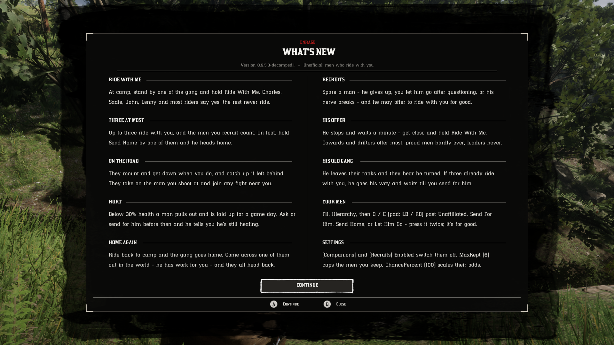

# enRAGE - decomped



> **Unofficial.** This is not the enRAGE author's code release, and it is not affiliated with or
> supported by them. The official mod is
> **[enRAGE - Living World and Nemesis System on Nexus Mods](https://www.nexusmods.com/reddeadredemption2/mods/10967)**.
> Report problems with this repository here, not to the enRAGE author. Free, never for sale.

enRAGE is a nemesis system for Red Dead Redemption 2 Story Mode. This repository is buildable
C# source for **enRAGE 0.9.5.3**, recovered from its `NemesisMod.dll` so that it can be patched
and extended. Build its `upstream` branch and you get the same `scripts/` files the official
download installs; `master` adds [0.9.5.3-decomped.1](#whats-new-in-0953-decomped1). No game
files, no mod binaries and no Script Hook files are stored here.

- The reconstruction (the `upstream` branch) matches the official 0.9.5.3 DLL member for
  member, and call, field and string for each method. The only exceptions are 12 small
  differences from a newer compiler, listed in [docs/RECONSTRUCTION.md](docs/RECONSTRUCTION.md).
- The mod's 86k-line main class is split into 150 feature files, following the order its
  author's own files were compiled in. The map is in [docs/ARCHITECTURE.md](docs/ARCHITECTURE.md).
- The reconstruction has passed an in-game smoke test on an existing save. It started cleanly
  with `errors 0`, and its menu, combat, greetings and save files all worked. The details and
  the limits of that test are in [docs/RECONSTRUCTION.md](docs/RECONSTRUCTION.md). The
  0.9.5.3-decomped.1 additions below were tested in game on 2026-10-25. The exception is
  camp companions at a gang camp; see [CHANGELOG.md](CHANGELOG.md).

## What's new in 0.9.5.3-decomped.1



`master` builds **0.9.5.3-decomped.1**: the reconstruction plus a first unofficial addition,
men who ride with you. Build the `upstream` branch for plain 0.9.5.3. Recruits were tested in game; camp companions at a gang camp were not yet.

- **Ride With Me.** The author's camp companions, which 0.9.5.3 shipped switched off, are on.
  At camp, hold the prompt by one of the gang; up to 3 ride with you, fight, get hurt and come
  home.
- **Recruits.** A man you spare may offer to ride with you for good. Your men are listed on
  the F11 menu's **Your Men** page: in Hierarchy, Q / E to the last chip, after Unaffiliated.
- **Settings.** `[Companions] Enabled` turns Ride With Me off. `[Recruits]` has `Enabled`,
  `MaxKept` (default 6) and `ChancePercent` (default 100).
- **Saves.** `world.json` gains a `Recruits` list. Saves from 0.9.5.3 load unchanged.

The details, the odds and the save notes are in [CHANGELOG.md](CHANGELOG.md).

## Build

You need the [.NET SDK](https://dotnet.microsoft.com/download) 8 or newer, on any OS: it
targets .NET Framework 4.8 through NuGet reference assemblies, so you don't need Windows to build.

**Linux, macOS, WSL, Git Bash** (needs `make`, `curl`, and `bsdtar`, `unrar` or `7z`):

```sh
make build
```

**Windows, plain `dotnet`:** point it at your game folder, which already holds
`ScriptHookRDRNetAPI.dll` once Script Hook RDR2 .NET is installed:

```bat
dotnet build -c Release -p:GameDir="C:\Program Files (x86)\Steam\steamapps\common\Red Dead Redemption 2"
```

Either way, `dist/scripts/` ends up with `NemesisMod.dll`, `NemesisMod.pdb` and `Newtonsoft.Json.dll`.

The build pulls only public, pinned inputs:
- `Newtonsoft.Json` 13.0.3 from NuGet, byte-identical to the copy enRAGE ships;
- `ScriptHookRDRNetAPI.dll` from the
  [ScriptHookRDR2DotNet V2 2.2.0 release](https://github.com/Halen84/ScriptHookRDR2DotNet-V2/releases/tag/2.2.0),
  checked by SHA-256 (`make fetch-api`). It's a compile-time reference only and never ends up in `dist/`.

## Install into the game

What you need is the same as for the official mod:

1. [ScriptHookRDR2](http://www.dev-c.com/rdr2/scripthookrdr2/) (Alexander Blade):
   `ScriptHookRDR2.dll` and `dinput8.dll` in the game folder.
2. [ScriptHookRDR2DotNet V2](https://github.com/Halen84/ScriptHookRDR2DotNet-V2/releases) 2.2.0 or
   newer: `ScriptHookRDRDotNet.asi`, `ScriptHookRDRDotNet.ini` and `ScriptHookRDRNetAPI.dll` in the game folder.
3. .NET Framework 4.8 and the Visual C++ 2015-2022 x64 redistributable (already present on most
   Windows 10/11 machines).

Then copy the contents of `dist/scripts/` into `<game>\scripts\` (the folder next to
`RDR2.exe`). From Linux, `make deploy` does it after setting `GAME_DIR` in `config.mk`
(copy `config.mk.example`). From Windows:

```bat
dotnet build -c Release -t:Deploy -p:GameDir="C:\...\Red Dead Redemption 2"
```

Start the game, load a **Story Mode** save and press **F11**. The first run writes
`scripts\NemesisMod.ini`. The mod keeps its world in
`Documents\Rockstar Games\Red Dead Redemption 2\enRAGE`, so it carries over an existing
enRAGE install. Keep only one `NemesisMod*.dll` in `scripts\`: the mod deactivates extra
copies. Never use Script Hook in Red Dead Online.

To uninstall, delete `NemesisMod.dll`, `NemesisMod.pdb`, `NemesisMod.ini` and `BulletImpact.ini`
from `scripts\`. Delete `Newtonsoft.Json.dll` too, unless another mod uses it.

## Working on it

- Find a feature in [docs/ARCHITECTURE.md](docs/ARCHITECTURE.md). Each system has its own
  `src/NemesisSystem/NemesisMod/NemesisMod.<Topic>.cs`. Read "Things that will bite" there first.
- `make check` builds and enforces static-initializer order, which is the one way a refactor
  here can silently break startup. `make deploy` runs it first.
- `make test` builds and runs the unit tests in `tests/NemesisMod.Tests` against the built DLL.
  It prints failures and a tally (`FILTER=Class` picks tests, `VERBOSE=1` shows everything).
  The tests can't call into the game, so they cover logic, settings and saves.
  For behaviour, read `grudges.log`: every `COMPANION` and `RECRUIT` step is logged.
- `make ci` runs `make check`, `make test` and `make invariants` (no binaries, nothing
  identifying, UTC commit dates) and ends with `ci: OK`. Run it before every commit.
- `make logs` follows `grudges.log` and Script Hook .NET's log. With the `.pdb` deployed,
  exceptions in the log show file and line. Companions log `COMPANION ...` lines, recruits
  `RECRUIT ...`.
- In game, Insert reloads scripts.

**With the official DLL.** Download enRAGE from Nexus and put its `NemesisMod.dll` in `upstream/`
(or set `UPSTREAM_DIR`). That enables:
- `make diff-upstream`: what your edits change against the official mod, as calls, field
  accesses and strings per method;
- `make verify`: the reconstruction gate, which passes on an untouched tree (`upstream`;
  on `master` it fails on the 0.9.5.3-decomped.1 changes, as expected);
- `make decompile`: regenerates the whole tree from a DLL, with `tools/decompile.sh` and ILSpy
  (`dotnet tool install -g ilspycmd --version 9.1.0.7988`);
- `make deploy-original`.

**When enRAGE updates.** Keep the plain decompile on the `upstream` branch and your changes on
`master`:

```sh
git switch upstream
make decompile UPSTREAM_DIR=/path/to/new/scripts      # -> build/upstream-src
rm -rf src Resources && cp -r build/upstream-src/src build/upstream-src/Resources .
git add -A && git commit -m "upstream 0.9.x"
git switch master && git rebase upstream
```

New files and boundaries are explained in [docs/RECONSTRUCTION.md](docs/RECONSTRUCTION.md).

## Layout

```
src/                       reconstructed C# (namespace NemesisSystem)
Resources/doors.json       embedded door table
tools/postdecompile.py     repairs applied to raw ILSpy output
tools/decompile.sh         DLL -> src pipeline
tools/Layout/              recovers member order and static-init dependencies from a DLL
tools/Splitter/            splits the main class into partial files (nemesismod.map)
tools/AsmDiff/             compares two builds by metadata, without loading them
tools/asmdiff-baseline.txt known differences from the official DLL
tests/NemesisMod.Tests/    unit tests against the built DLL (make test, make ci)
docs/                      architecture and reconstruction notes
dist/ lib/ upstream/       build output, downloaded reference, official DLL (untracked)
```

## Licence and credits

The code in `src/` and `Resources/` is enRAGE's. It is used under **enRAGE's licence**, included
verbatim in [LICENSE](LICENSE), which allows decompiling and modifying it and sharing changes
with credit, free of charge, and marked unofficial. Selling enRAGE or anything made from it is
not allowed. Third-party notices are in [THIRD-PARTY.txt](THIRD-PARTY.txt).

- enRAGE by the enRAGE author:
  [Nexus Mods](https://www.nexusmods.com/reddeadredemption2/mods/10967).
- ScriptHookRDR2 by Alexander Blade. ScriptHookRDR2DotNet V2 by Halen84 and contributors.
  Newtonsoft.Json by James Newton-King (MIT).
- Game data references from [femga/rdr3_discoveries](https://github.com/femga/rdr3_discoveries)
  and the [RDR3 native database](https://alloc8or.github.io/rdr3-native-db/), as credited by enRAGE.
- Decompiled with [ILSpy](https://github.com/icsharpcode/ILSpy).
- Cover art ([docs/cover.svg](docs/cover.svg)) uses the Rye, Cinzel and Oswald fonts (SIL Open Font Licence).

Red Dead Redemption 2 belongs to Rockstar Games / Take-Two Interactive. This is a fan project,
not affiliated with or endorsed by them.
